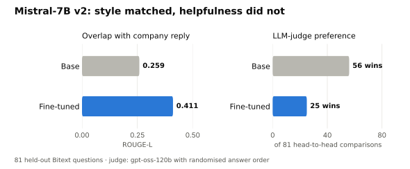
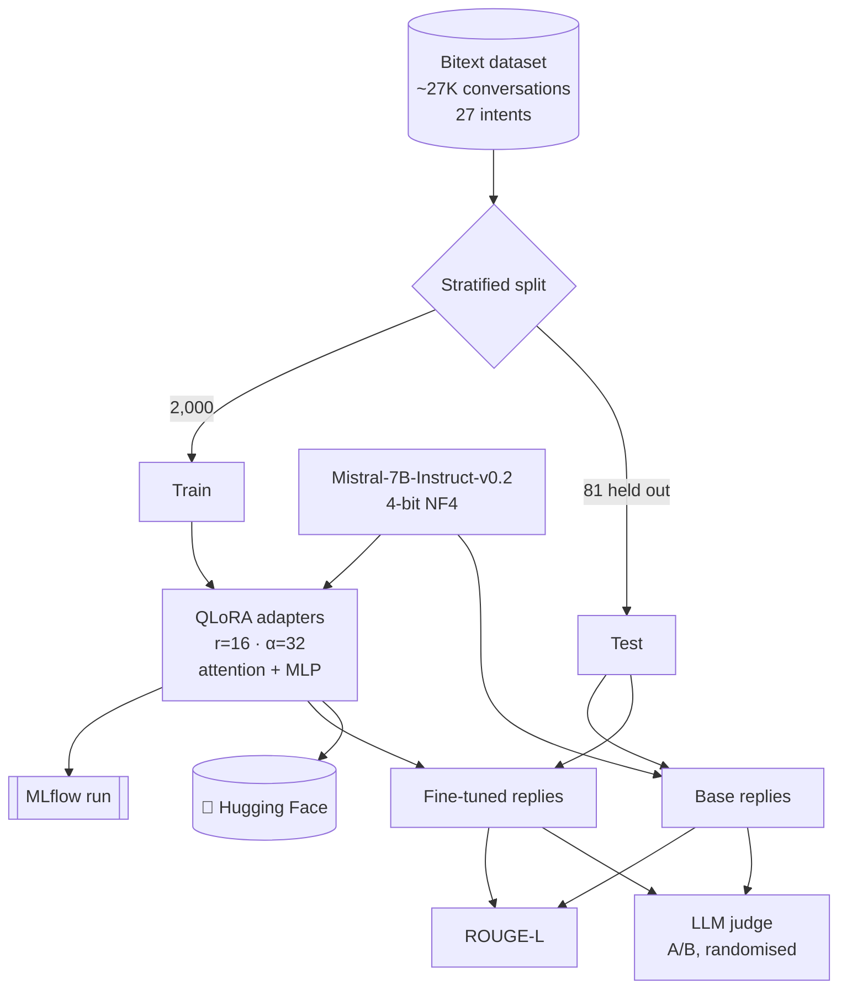

<div align="center">

# 🎧 Mistral-7B Customer-Support Fine-Tune (QLoRA)

### Fine-tuning Mistral-7B-Instruct on real-style support conversations on a free GPU, and measuring honestly whether it helped.

<p>
  <a href="https://colab.research.google.com/github/Anikate001/-Fine-tune-Mistral-7B-with-QLoRA/blob/main/finetune_v2_bitext_eval.ipynb"></a>
  <a href="https://huggingface.co/Anikate0/mistral-7b-bitext-support-qlora"></a>
</p>
<p>
  
  
  
  
</p>

[Results](#-results) · [How it works](#-how-it-works) · [Run it](#-run-it) · [Use the adapter](#-use-the-adapter)

</div>

---

## 📊 Results

Evaluated on **81 held-out questions** (3 per intent, never seen in training) against the base model.

<picture>
  <source media="(prefers-color-scheme: dark)" srcset="docs/mistral_results_dark.svg">
  
</picture>

| Metric | Base Mistral-7B-Instruct | Fine-tuned |
|---|---|---|
| ROUGE-L vs company reference reply | 0.259 | **0.411** (+59%) |
| LLM-judge preference (`gpt-oss-120b`, randomised order) | **56 / 81 (69%)** | 25 / 81 (31%) |

> **The takeaway:** fine-tuning clearly taught the model the company's reply style; overlap with reference replies
> rose 59%. But a judge comparing helpfulness preferred the base instruct model 69% of the time. The Bitext replies
> are short and templated (with placeholders like `{{Order Number}}`), while the base model already gives fuller
> answers. Measuring with two metrics surfaced this, where a single overlap score would have hidden it.

**Next experiments:** a preference stage (DPO) using the judge's verdicts as labels; fuller, higher-quality target
replies; 2-3 epochs at a lower learning rate; a manual review of the cases where ROUGE-L and the judge disagree.

Raw numbers: [`results/results.json`](results/results.json). Model card for the Hugging Face page: [`huggingface_model_card.md`](huggingface_model_card.md).

## 🧭 How it works



| Setting | Value |
|---|---|
| Base model | `mistralai/Mistral-7B-Instruct-v0.2` |
| Quantisation | 4-bit NF4 with double quantisation (bitsandbytes) |
| LoRA | r = 16, α = 32, dropout 0.05, on q/k/v/o and gate/up/down projections |
| Trainable parameters | 42M of 7.3B (0.58%) |
| Data | 2,000 training samples, stratified across 27 intents |
| Training | 1 epoch, 125 steps, effective batch 16, lr 2e-4 cosine, bf16, paged AdamW 8-bit |
| Hardware / time | Google Colab T4 (16 GB), 34 minutes |
| Training loss | 1.69 → 0.57 |
| Tracking | MLflow (training run plus held-out evaluation run) |

## ▶️ Run it

Open [`finetune_v2_bitext_eval.ipynb`](finetune_v2_bitext_eval.ipynb) in Colab (button above), then:

1. **Runtime → Change runtime type → T4 GPU.**
2. Add two Colab secrets (🔑 sidebar) with notebook access on: `HF_TOKEN` (a Hugging Face **write** token) and
   `GROQ_API_KEY` (for the judge).
3. **Runtime → Run all.** Expect about 1.5 hours end to end. The notebook prints a results block and publishes the
   adapter.

Judging, logging and publishing live in [`scripts/judge_and_report.py`](scripts/judge_and_report.py), and
[`scripts/continue_from_training.py`](scripts/continue_from_training.py) resumes a session from the training step.

## 💬 Use the adapter

```python
# pip install transformers peft accelerate bitsandbytes torch
from inference_demo import respond
print(respond("I was charged twice for my order, can you help?"))
```

See [`inference_demo.py`](inference_demo.py). It loads the base model in 4-bit (about 6 GB of GPU memory) and
uses the same prompt template as training.

<details>
<summary><b>📜 v1 (first version) and why it was replaced</b></summary>

v1 ([`finetune_qlora.ipynb`](finetune_qlora.ipynb)) trained on 500 synthetic samples built from 8 fixed templates
by [`generate_dataset.py`](generate_dataset.py). Training loss fell quickly, but the model mostly learned to repeat
those 8 replies, for example answering "the colour faded after washing" with a replacement offer. Testing on more of
the same templates would only have measured memorisation, so v2 moved to a real dataset with a held-out split and
two independent metrics. The v1 adapter is still at
[Anikate0/mistral-7b-customer-support-qlora](https://huggingface.co/Anikate0/mistral-7b-customer-support-qlora).

</details>

## 📁 Repository

```
├── finetune_v2_bitext_eval.ipynb   # v2: data, QLoRA training, evaluation, publishing
├── scripts/                        # judge + report, resume-from-training helpers
├── results/results.json            # v2 evaluation numbers
├── huggingface_model_card.md      # model card published on Hugging Face
├── inference_demo.py               # chat with the published adapter
├── docs/                           # result charts
├── finetune_qlora.ipynb            # v1 notebook
└── generate_dataset.py             # v1 synthetic data generator
```
